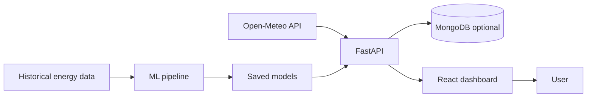

# Energy Intelligence

Energy Demand Forecasting & Anomaly Detection Platform.

This is an educational / portfolio project. It combines historical energy consumption, weather information, and machine learning to forecast demand and flag unusual consumption.

**Current status:** Complete local application — trained model, residual anomalies, FastAPI product APIs, and React dashboard. MongoDB is optional (needed only for the contact form).

---

## Project Overview

The goal is to turn a trained time-series model into a real web application:

- FastAPI backend for health checks, weather, forecasts, anomalies, and dashboard summaries
- React dashboard for charts and explanations
- MongoDB for contact messages (optional)
- Open-Meteo for weather inputs

Training stays offline. The API loads a saved model instead of retraining on every request.

## Problem Statement

Predict Spain’s **next-hour electricity demand** (national load in MW) using recent consumption, calendar/time features, and last-known Madrid weather from Open-Meteo.

Anomaly detection flags hours where actual load differs unusually from the forecast. Results are estimates for an educational project, not operational grid decisions.

Details: [docs/problem_definition.md](docs/problem_definition.md)

## Demo / Screenshots

Run locally (see below) and open [http://localhost:5173](http://localhost:5173). The dashboard, forecast, anomalies, analytics, and model pages all read from the trained model — they do not use placeholder numbers.

## Features

**Available now**

- Project folder structure and local development environment
- FastAPI health, weather, forecast, anomaly, dashboard, analytics, model-metrics, and contact endpoints
- React pages wired to those APIs (Dashboard, Forecast, Anomalies, Analytics, Model, Methodology, Contact)
- MongoDB configuration that does not require credentials for forecasts
- Documented ML target and a downloadable Spanish hourly load dataset
- Jupyter notebooks for data quality checks, EDA, features, training, and evaluation
- Leakage-safe hourly forecast features (calendar, lags, last-known weather)
- Trained one-hour-ahead Histogram Gradient Boosting model with a documented baseline comparison
- Residual anomaly flags using 2× / 3× 2019 validation MAE

## Architecture



See [docs/architecture.md](docs/architecture.md) for the folder layout and [docs/problem_definition.md](docs/problem_definition.md) for the forecasting target.

## Technology Stack

| Area | Choice |
| --- | --- |
| Backend | Python, FastAPI, Pydantic, Uvicorn |
| Database | MongoDB Atlas (optional; contact form only) |
| Frontend | React.js, Vite, JavaScript, Tailwind CSS, Recharts |
| ML | Pandas, NumPy, Scikit-learn, Joblib, Matplotlib, Jupyter |
| Weather | Open-Meteo (no API key) |

## Dataset

Spanish hourly electricity load extracted from [Open Power System Data time series 2020-10-06](https://doi.org/10.25832/time_series/2020-10-06) (original series: ENTSO-E Transparency).

| Column | Meaning |
| --- | --- |
| `utc_timestamp` | Hour in UTC |
| `cet_cest_timestamp` | Hour in Spain local time |
| `load_mw` | National demand in megawatts |

Download:

```powershell
.\.venv\Scripts\python.exe scripts\download_dataset.py
```

The CSV is stored in `data/raw/` and is gitignored. See [data/README.md](data/README.md).

**Coverage:** 2015 through 30 September 2020. The UI is a historical reconstruction, not a live Spain grid feed.

## External API

[Open-Meteo](https://open-meteo.com/) provides Madrid hourly weather (temperature, relative humidity, wind speed). There is no API key. Coordinates and base URLs live in `backend/.env`, not in the React app.

Historical hours are cached in `data/processed/madrid_hourly_weather.csv` so the same years are not re-downloaded. Current weather is cached in memory for 10 minutes.

```powershell
.\.venv\Scripts\python.exe ml_pipeline\download_weather.py
```

## Data Pipeline

Raw load is downloaded by `scripts/download_dataset.py`. Quality checks and EDA live in:

- `notebooks/01_data_understanding.ipynb` — missing values, duplicates, hourly grid, cleaning rules
- `notebooks/02_eda.ipynb` — daily/weekly/seasonal patterns, 2020 shift, lag correlations

Cleaning is implemented in `backend/app/ml/preprocessing.py` and run with:

```powershell
.\.venv\Scripts\python.exe ml_pipeline\prepare_data.py
```

That writes `data/processed/spain_hourly_load.csv`. Short interior gaps (1–3 hours) are interpolated. Longer gaps, and the start/end of the series, stay missing. Peaks are not clipped.

Weather is stored separately as `data/processed/madrid_hourly_weather.csv` (Madrid, Open-Meteo). Features are built with:

```powershell
.\.venv\Scripts\python.exe ml_pipeline\build_features.py
```

Open notebooks:

```powershell
cd "C:\Users\Hammad Ali\Energy Intelligence"
.\.venv\Scripts\python.exe -m jupyter notebook notebooks
```

## Feature Engineering

Implemented in `backend/app/ml/features.py`. Each row is the hour being predicted (`t`). Inputs never include `load_mw` at `t`.

| Feature | Meaning |
| --- | --- |
| `hour`, `day_of_week`, `month`, `is_weekend` | Spain local calendar at `t` |
| `lag_1`, `lag_24`, `lag_168` | Load at t−1, yesterday, last week |
| `rolling_mean_24`, `rolling_mean_168` | Mean load ending at t−1 |
| `temperature_c`, `relative_humidity_pct`, `wind_speed_kmh` | Madrid weather at t−1 |

```powershell
.\.venv\Scripts\python.exe ml_pipeline\build_features.py
```

See `notebooks/03_feature_engineering.ipynb`.

## ML Models

Offline training: `ml_pipeline/train.py`. The API must **load** the saved file, not retrain.

| Model | Valid MAE (MW) | Test MAE (MW) |
| --- | ---: | ---: |
| Persistence (`lag_1`) | 1030.20 | 1006.85 |
| Moving average 24 | 3254.23 | 3019.60 |
| Linear regression | 765.46 | 733.92 |
| Random forest | 273.48 | 398.84 |
| **Histogram gradient boosting (selected)** | **227.02** | **311.33** |

Split: train through 2018, validate 2019, test 2020. **Not shuffled.** 2020 is a COVID stress year, so test MAE is expected to be worse than validation. XGBoost was not added; sklearn histogram gradient boosting already covers that family.

Selected by **lowest 2019 validation MAE**. Test numbers were not used to choose the model.

## Model Evaluation

From `models/model_metadata.json` for the selected model:

| Split | MAE | RMSE | MAPE |
| --- | ---: | ---: | ---: |
| 2019 validation | 227.02 MW | 313.49 MW | 0.801% |
| 2020 test | 311.33 MW | 443.58 MW | 1.237% |

These are measured errors in megawatts, not invented accuracy percentages. See `notebooks/04_model_training.ipynb` and `notebooks/05_model_evaluation.ipynb`.

## Anomaly Detection

Residual method in `backend/app/ml/anomaly_detector.py`:

- Medium: `|actual − predicted| >= 2 × 2019 validation MAE` (454.04 MW)
- High: `|actual − predicted| >= 3 × 2019 validation MAE` (681.06 MW)

An anomaly means unusual consumption relative to the forecast. It is **not** proof of equipment failure.

```powershell
.\.venv\Scripts\python.exe ml_pipeline\detect_anomalies.py
```

The API also scores residuals in memory at startup, so the CSV is optional.

## API Endpoints

| Method | Path | Status |
| --- | --- | --- |
| GET | `/api/v1/health` | Available |
| GET | `/api/v1/weather` | Available |
| GET | `/api/v1/energy/history` | Available |
| GET | `/api/v1/forecast/latest` | Available |
| GET | `/api/v1/forecasts/recent` | Available (MongoDB if connected, otherwise the feature table) |
| POST | `/api/v1/forecast` | Available |
| GET | `/api/v1/anomalies` | Available |
| GET | `/api/v1/anomalies/{id}` | Available |
| GET | `/api/v1/dashboard/summary` | Available |
| GET | `/api/v1/analytics` | Available |
| GET | `/api/v1/model/metrics` | Available |
| POST | `/api/v1/contact` | Available if MongoDB is connected; otherwise 503 |

Interactive docs (development only): [http://localhost:8000/docs](http://localhost:8000/docs)

## Installation

### Requirements

- Python 3.11+ (3.12 is a good default for later data-science packages)
- Node.js 20+
- npm
- A MongoDB Atlas URI only when you want the contact form to persist messages

### Backend

```powershell
cd "C:\Users\Hammad Ali\Energy Intelligence"
py -m venv .venv
.\.venv\Scripts\python.exe -m pip install --upgrade pip
.\.venv\Scripts\python.exe -m pip install -r backend\requirements.txt
copy backend\.env.example backend\.env
```

Train and build artifacts if they are not already present:

```powershell
.\.venv\Scripts\python.exe scripts\download_dataset.py
.\.venv\Scripts\python.exe ml_pipeline\prepare_data.py
.\.venv\Scripts\python.exe ml_pipeline\download_weather.py
.\.venv\Scripts\python.exe ml_pipeline\build_features.py
.\.venv\Scripts\python.exe ml_pipeline\train.py
```

Optional Mongo indexes:

```powershell
.\.venv\Scripts\python.exe scripts\seed_database.py
```

### Frontend

```powershell
cd "C:\Users\Hammad Ali\Energy Intelligence\frontend"
copy .env.example .env
npm install
```

## Environment Variables

Backend (`backend/.env`):

```
MONGODB_URI=your_mongodb_connection_string
MONGODB_DB_NAME=energy_intelligence
DATABASE_NAME=energy_intelligence
FRONTEND_URL=http://localhost:5173
ENVIRONMENT=development
WEATHER_API_BASE_URL=https://api.open-meteo.com/v1
WEATHER_ARCHIVE_API_BASE_URL=https://archive-api.open-meteo.com/v1
WEATHER_LATITUDE=40.4168
WEATHER_LONGITUDE=-3.7038
WEATHER_LOCATION_NAME=Madrid
WEATHER_TIMEOUT_SECONDS=20
```

Leave `MONGODB_URI` empty until you have an Atlas connection string. Forecasts still work.

Frontend (`frontend/.env`):

```
VITE_API_BASE_URL=http://localhost:8000
```

Do not put secrets in `VITE_*` variables. Those values are visible in the browser.

## Running Locally

Terminal 1 — API:

```powershell
cd "C:\Users\Hammad Ali\Energy Intelligence\backend"
& "..\.venv\Scripts\python.exe" -m uvicorn app.main:app --reload --host 127.0.0.1 --port 8000
```

Startup loads the feature table and model once. Expect a short delay.

Terminal 2 — UI:

```powershell
cd "C:\Users\Hammad Ali\Energy Intelligence\frontend"
npm run dev
```

Open [http://localhost:5173](http://localhost:5173).

Run backend tests:

```powershell
cd "C:\Users\Hammad Ali\Energy Intelligence\backend"
& "..\.venv\Scripts\python.exe" -m pytest
```

## Project Structure

```
Energy Intelligence/
├── backend/          FastAPI application
├── frontend/         React + Vite UI
├── data/             Raw and processed datasets
├── scripts/          Dataset download and optional Mongo seed
├── ml_pipeline/      Offline data prep, training, anomaly export
├── notebooks/        EDA and training notebooks
├── models/           Saved ML artifacts
├── docs/             Architecture and problem definition
├── .gitignore
├── LICENSE
└── README.md
```

## Security Considerations

- Secrets live in `.env`, which is gitignored
- CORS origins come from `FRONTEND_URL`, not a hardcoded `*`
- Unexpected errors return a generic message; stack traces stay in logs
- MongoDB is optional until credentials are provided
- Contact form is rate-limited (5 posts / minute / IP) and length-limited
- No authentication; this is a public educational demo

## Limitations

- Historical extract ends 30 September 2020 — not live grid data
- National load is paired with a single Madrid weather point
- 2020 test error is worse because of COVID-related demand changes
- Contact storage requires MongoDB Atlas
- This is an educational / portfolio project, not an operational energy-trading or dispatch tool

## Future Improvements

- Refresh the load series past 2020 if a newer public extract is used
- Regional weather instead of Madrid-only
- Multi-hour forecasts
- Authentication if the contact inbox needs protection

## License

MIT. See [LICENSE](LICENSE).
