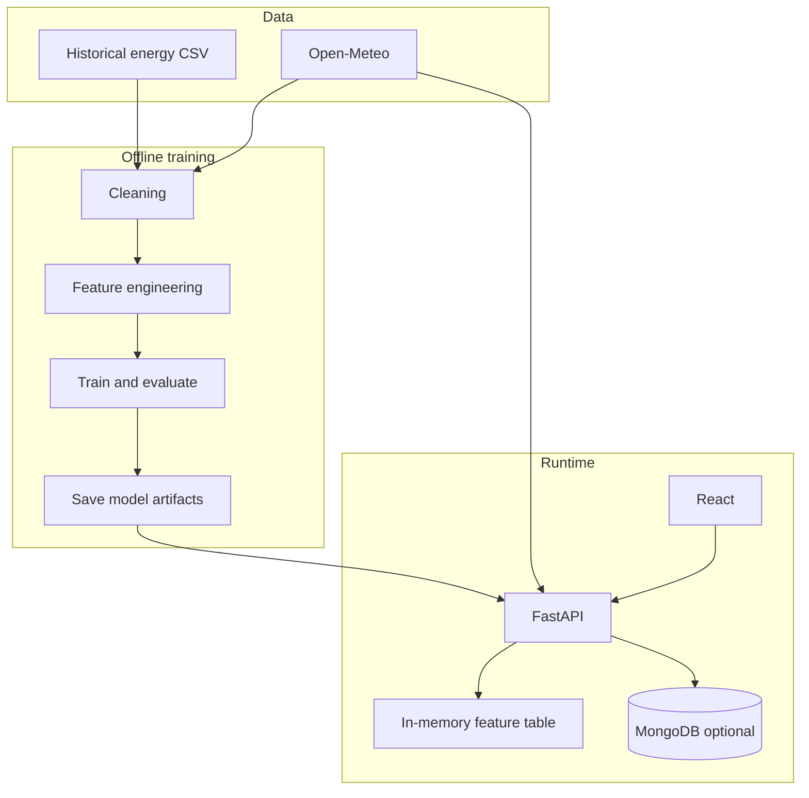
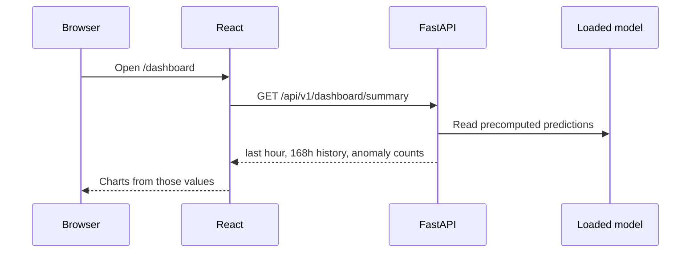

# Architecture

Energy Intelligence is a single application with two local processes:

1. **FastAPI** (`backend/`) — API, configuration, model loading, and inference
2. **React + Vite** (`frontend/`) — user interface

MongoDB is optional. Forecasts, anomalies, and charts run from CSV files plus the saved sklearn model. MongoDB is used only to store contact messages.

## Runtime flow

At startup the API loads:

- `data/processed/spain_hourly_features.csv`
- `data/processed/spain_hourly_load.csv`
- `data/processed/madrid_hourly_weather.csv`
- `models/forecast_model.joblib`
- `models/model_metadata.json`

It predicts every feature row once, attaches residual severity, and serves those values to the dashboard.

## What each major folder does

| Path | Role |
| --- | --- |
| `backend/app/main.py` | Creates the FastAPI app, CORS, logging, and startup |
| `backend/app/core/` | Settings and logging |
| `backend/app/api/routes/` | HTTP endpoints |
| `backend/app/database/` | Optional MongoDB connection |
| `backend/app/ml/` | Preprocessing, features, metrics, predictor, anomaly rule |
| `backend/app/services/` | Weather client, loaded data, forecast/anomaly/contact logic |
| `ml_pipeline/` | Offline scripts: prepare, weather, features, train, evaluate, anomalies |
| `scripts/seed_database.py` | Optional contact_messages indexes |
| `models/model_metadata.json` | Real evaluation metrics |
| `frontend/src/pages/` | Dashboard, forecast, anomalies, analytics, model, legal pages |
| `docs/` | Architecture and problem definition |

## Request flow (dashboard)

## Simplifications vs the original sketch

- **PyMongo, not Motor.** Sync PyMongo is easier to read and enough for this project.
- **No auth / users collection.** Out of scope for the first portfolio version.
- **MongoDB is optional.** The product APIs run from files.
- **Training is offline.** The API never fits a new model on a request.
- **Residual anomalies, not a second classifier.** Uses 2× / 3× validation MAE.
